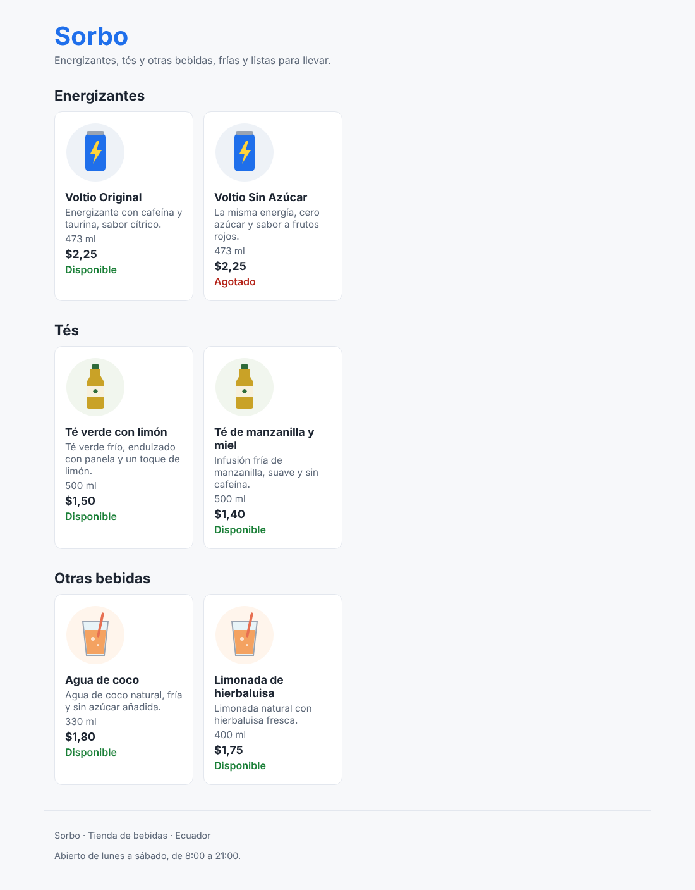

# Tarea · El esqueleto de mi emprendimiento en React

**Emprendimiento:** *Sorbo*, tienda de bebidas (energizantes, tés y otras bebidas).
El proyecto está en `tienda-bebidas/` (Vite + React).

```bash
cd tienda-bebidas
npm install
npm run dev        # http://localhost:5173/
```



## Estructura

```
tienda-bebidas/
├── index.html                 lang="es", título de la tienda
├── public/images/             lata.svg, botella-te.svg, vaso.svg (marcadores de posición)
└── src/
    ├── main.jsx               monta <App /> en #root
    ├── App.jsx                los datos de los productos y la vista
    ├── index.css
    └── components/
        ├── Header.jsx         <header> con el <h1> de la tienda
        ├── Footer.jsx         <footer> con ciudad y horario
        ├── Section.jsx        contenedor con children (una por categoría)
        └── ProductCard.jsx    tarjeta de producto que recibe su dato por props
```

Árbol de componentes (de la actividad 12):

```
App
├── Header
├── Section "Energizantes"  → ProductCard ×2
├── Section "Tés"           → ProductCard ×2
├── Section "Otras bebidas" → ProductCard ×2
└── Footer
```

## Lista de requisitos

| Requisito de la tarea | Cómo se cumple |
|---|---|
| Header, Footer y un contenedor con children | `Header.jsx`, `Footer.jsx` y `Section.jsx`, que coloca `{children}` debajo de su título |
| Una tarjeta que recibe su dato por props | `ProductCard` recibe `product` y no lee nada de fuera (función pura) |
| Un componente por archivo en `src/components` | 4 archivos, cada uno con `export default` |
| Tarjetas con `aria-labelledby` y encabezados en orden | Cada `<article>` apunta al `id` de su `<h3>`, derivado del dato (`product-1-name`…). Jerarquía `h1` (tienda) → `h2` (sección) → `h3` (producto). Cada `<section>` también se nombra con `aria-labelledby` (id generado con `useId`, para que no se repita entre secciones) |
| Consola sin avisos | Comprobado en el navegador: 0 mensajes. `npm run lint` (oxlint) y `npm run build` sin errores |

Comprobación automática hecha: 10 `id` en la página, los 10 únicos, y ningún `aria-labelledby`
apunta a un `id` inexistente.

Otros detalles de accesibilidad: las imágenes llevan `alt=""` (son decorativas; el nombre ya está
en el `<h3>`), y «Disponible»/«Agotado» está **escrito**, no solo indicado con color.

> Las tarjetas se escriben una por una (sin `Array.map`) porque las listas y el prop `key` son del
> capítulo 04; el nombre «Sorbo» y los productos son de ejemplo y se pueden cambiar en `App.jsx`.
